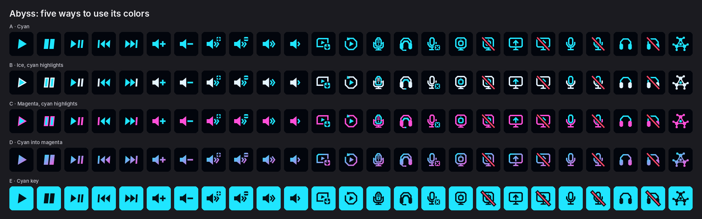
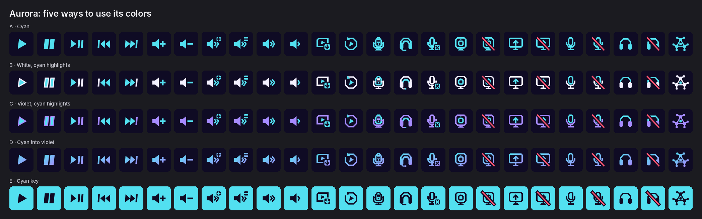
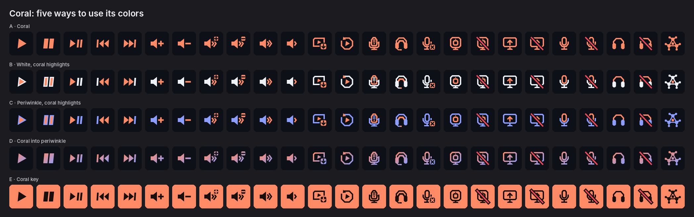
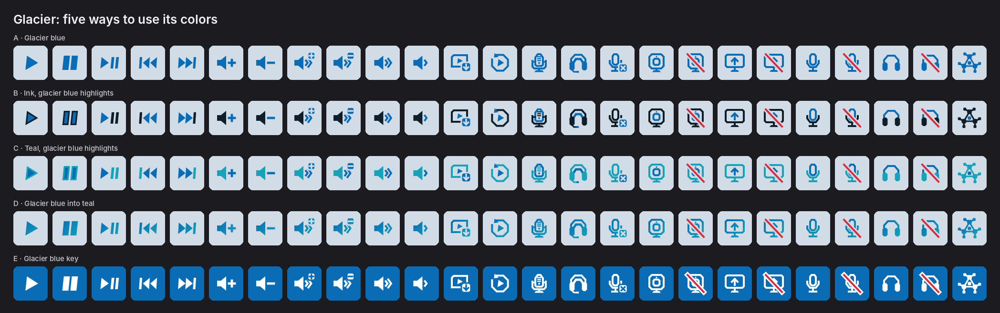
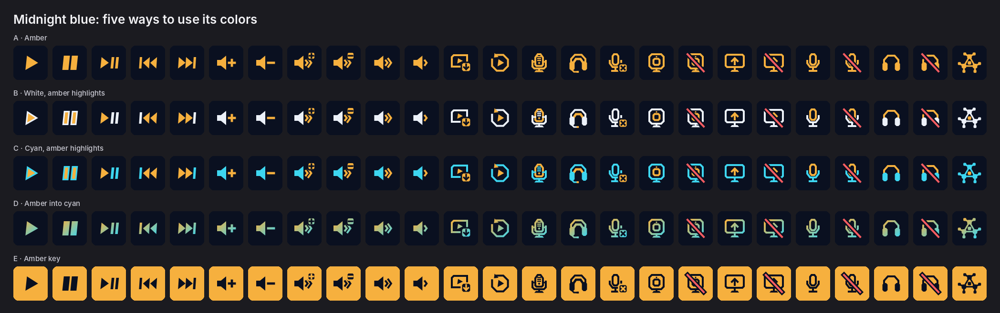
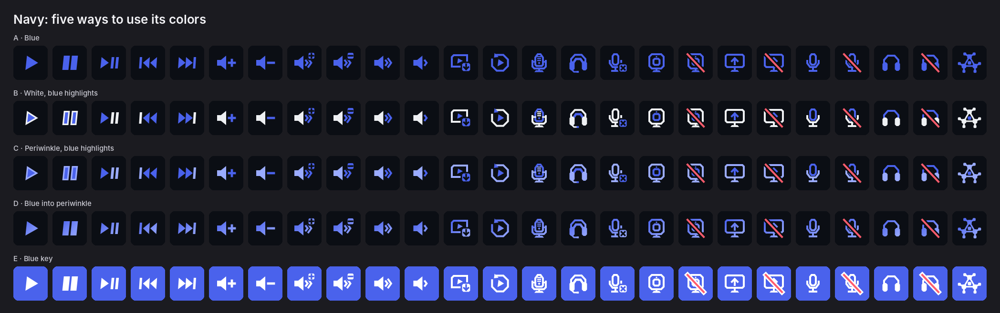
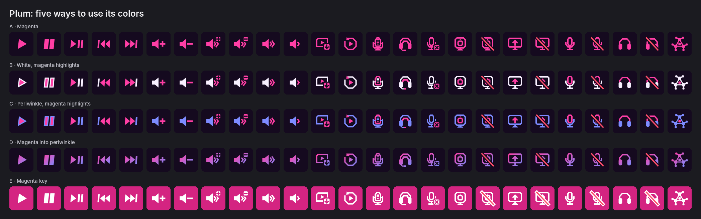
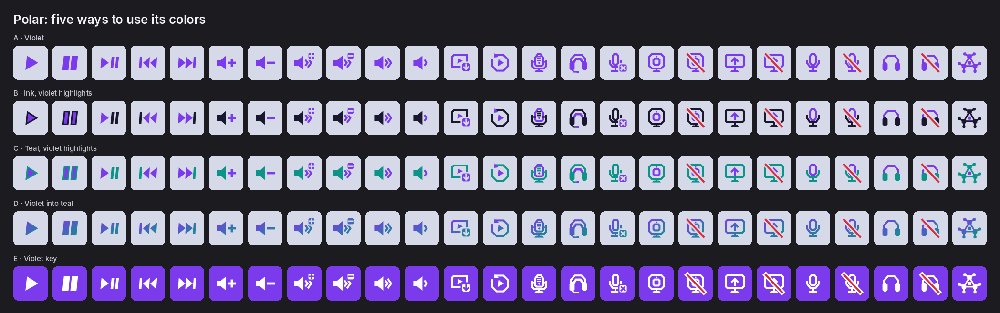
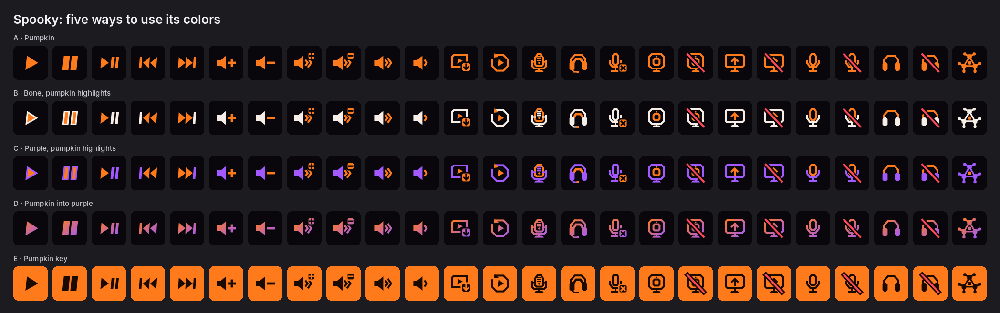
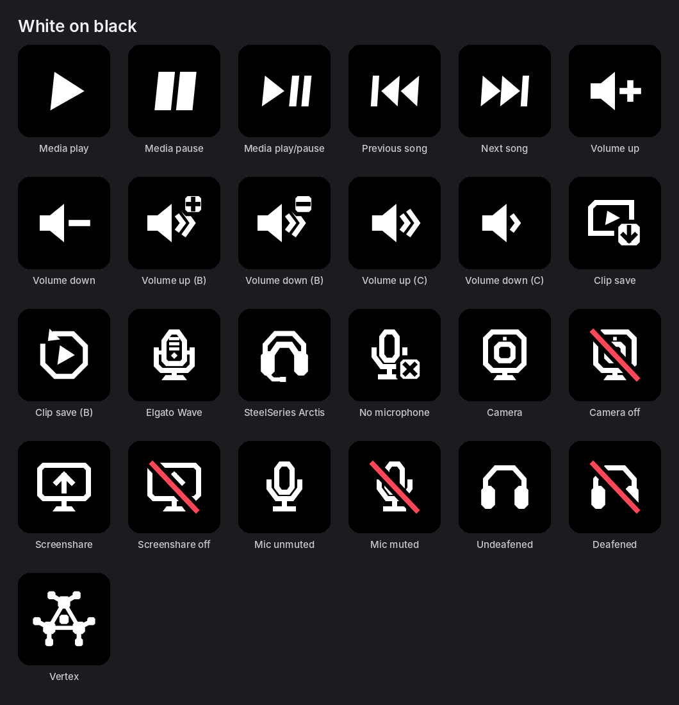

# Vertex Media for StreamController

Stream Deck keys for [Vertex](https://github.com/StellarGalaxyAtlas/vertex),
the [Discord](https://discord.com) app and the media playing on your
desktop, through [StreamController](https://github.com/StreamController/StreamController)
on Linux. Every key is drawn in the icons of one Vertex theme, and always
shows its app's current state, whatever changed it.

This plugin joins the Vertex plugin (vertex-streamcontroller) and the Vertex
Discord plugin (vertex-discord-streamcontroller) into one, and adds keys for
playing, pausing and skipping media. The Discord part is based on
[DiscordSC](https://github.com/oparada1988/DiscordSC), which showed how to
reach Discord's local RPC socket from StreamController.

## The keys

| Key | What it does |
| --- | --- |
| Sonar Information | Shows a channel's volume, or "Muted", as a tile drawn like the icons in the theme's colors (or as plain labels) |
| Sonar Volume | Turns a channel up or down by a step you set. On a dial: turn to change, press to mute |
| Sonar Toggle Channel Mute | Mutes or unmutes a channel |
| Sonar Next Microphone | Switches to the next mic in the device manager's list |
| Sonar Next Output Device | Switches to the next output in the device manager's list |
| Sonar Toggle Microphone | Switches between two mics you pick |
| Sonar Toggle Output Device | Switches between two outputs you pick |
| Replay Buffer Toggle | Starts or stops the replay buffer |
| Replay Save Clip | Saves a clip of the length you pick, and flashes green when it lands |
| Show Vertex | Brings Vertex's window to the front |
| Discord Toggle Mute | Mutes or unmutes your mic in Discord |
| Discord Toggle Deafen | Deafens or undeafens you in Discord |
| Discord Toggle Camera | Turns your camera on or off in the call you're in |
| Discord Toggle Screen Share | Starts sharing (Discord asks what to share, as its own button does) or stops it |
| Discord Voice Channel | Joins the voice channel picked in the key's settings, moving from another one. Pressed while in it, leaves it, unless set to stay |
| Media Play/Pause | Plays or pauses, showing the pause sign while it plays and the play sign while it doesn't. Can be set to only play or only pause. On a dial: turn for the next or previous song, press to play or pause |
| Media Next | Skips to the next song |
| Media Previous | Goes back to the previous song |

The channel, step, devices, clip length, voice channel and media player are
set in each key's settings. Device switches last until a device is plugged
in or out, as in Vertex.

### Media keys

The media keys work with any player that shows up in the desktop's own
media controls (Spotify, Firefox, Chromium, mpv, VLC, and most others),
through [MPRIS](https://specifications.freedesktop.org/mpris-spec/latest/).
They control the player that is playing, or the one that played last; in a
key's settings, **Player** can tie it to one player instead. The keys show
the song's title under the icon (**Show the song**, and **With the artist**
to add who sings it), and fade when no player is running.

They need `gdbus`, which comes with GLib on every Linux desktop. Inside the
Flathub StreamController they reach it through `flatpak-spawn --host`, which
needs no setup.

### Discord keys

Camera and screen share work only in a call; outside one the keys fade and
say "No call". Their icons show what a press does next: the plain camera
or screen while it's off, the crossed one while it's on.

#### Camera and screen share

Discord's RPC has `TOGGLE_VIDEO` and `TOGGLE_SCREENSHARE`, the commands the
Elgato Stream Deck plugin uses on Windows. Discord doesn't document them
officially, and they need the `rpc.video.*` and `rpc.screenshare.*` scopes,
which Discord may not grant to every app. The plugin asks for them when you
authorize it; if Discord refuses them, it logs in without them, and only
these two keys may not work. Both work in Discord's Linux client.

`TOGGLE_SCREENSHARE` can't pick a screen: it takes only a process to share
the window of, and without one Discord shows its picker. So every start asks
what to share.

## Settings

StreamController's plugin page, vertex-unified-plugin, Settings, has one section
per part:

- **Look** picks the **Theme** and its **Version** for every key at once,
  Vertex's, Discord's and the media keys alike, and shows all the icons in
  the theme picked. The versions are named for what they look like in that
  theme. With the theme set to None, the keys show labels instead of icons.
- **Vertex**, **Discord** and **Media** each show whether the plugin
  reaches that app. Discord's has **Authorize**, and **Set up** with your
  Discord app's details (see below).

Over an icon a key keeps only the label the icon can't show, such as the
device in use, the song, or "Vertex off", and fades the icon while its app
is off. Sonar Information draws its tile in the theme's colors.

### A key's own icon

Every key with an icon has, in its own settings, one **Icon** row for each
state it shows (such as "Icon when muted" and "Icon when on"). Open it to
pick:

- **Icon**: any of the plugin's icons, drawn in the plugin's theme;
- **Variant**: for icons drawn more than one way (Volume Up and Volume Down
  have A, B and C, Clip Save has A and B), which one. This works for the
  key's default icon too, so a Sonar Volume key can use Volume Up C without
  picking anything else;
- **Your own picture, instead**: a picture of your own, which comes first.

The row's subtitle says what the key shows. Leave the key's own image in
StreamController empty, or it covers all of these.

The information tile uses [Chakra Petch](https://fonts.google.com/specimen/Chakra+Petch)
Bold, which comes with the plugin (`assets/fonts`, under the SIL Open Font License).

## Icons

`assets/icons/` has 25 key icons (mics, headset, mute, volume, clips, media,
camera, screen share, the Vertex logo) as 144 px PNG and SVG. There is a white set, and a set
for each of Vertex's nine color schemes in five versions:

- **A**: the scheme's main color
- **B**: the text color, with main-color highlights
- **C**: the second color, with main-color highlights
- **D**: a gradient from the main color into the second
- **E**: a key filled with the main color

`assets/icons/_previews` has an overview sheet for each theme (`<Theme>.png`, all five
versions side by side) and one per version (`<Theme>/<Version>.png`, every icon
with its name). `assets/icons/source` has the scripts that draw them.

### Overviews

Each theme with its five versions. The links under each open one version's
sheet, with every icon and its name.

#### Abyss



[A: Cyan](assets/icons/_previews/Abyss/A_Cyan.png) · [B: Ice Cyan Highlights](assets/icons/_previews/Abyss/B_Ice_Cyan_Highlights.png) · [C: Magenta Cyan Highlights](assets/icons/_previews/Abyss/C_Magenta_Cyan_Highlights.png) · [D: Cyan Into Magenta](assets/icons/_previews/Abyss/D_Cyan_Into_Magenta.png) · [E: Cyan Key](assets/icons/_previews/Abyss/E_Cyan_Key.png)

#### Aurora



[A: Cyan](assets/icons/_previews/Aurora/A_Cyan.png) · [B: White Cyan Highlights](assets/icons/_previews/Aurora/B_White_Cyan_Highlights.png) · [C: Violet Cyan Highlights](assets/icons/_previews/Aurora/C_Violet_Cyan_Highlights.png) · [D: Cyan Into Violet](assets/icons/_previews/Aurora/D_Cyan_Into_Violet.png) · [E: Cyan Key](assets/icons/_previews/Aurora/E_Cyan_Key.png)

#### Coral



[A: Coral](assets/icons/_previews/Coral/A_Coral.png) · [B: White Coral Highlights](assets/icons/_previews/Coral/B_White_Coral_Highlights.png) · [C: Periwinkle Coral Highlights](assets/icons/_previews/Coral/C_Periwinkle_Coral_Highlights.png) · [D: Coral Into Periwinkle](assets/icons/_previews/Coral/D_Coral_Into_Periwinkle.png) · [E: Coral Key](assets/icons/_previews/Coral/E_Coral_Key.png)

#### Glacier



[A: Glacier Blue](assets/icons/_previews/Glacier/A_Glacier_Blue.png) · [B: Ink Glacier Blue Highlights](assets/icons/_previews/Glacier/B_Ink_Glacier_Blue_Highlights.png) · [C: Teal Glacier Blue Highlights](assets/icons/_previews/Glacier/C_Teal_Glacier_Blue_Highlights.png) · [D: Glacier Blue Into Teal](assets/icons/_previews/Glacier/D_Glacier_Blue_Into_Teal.png) · [E: Glacier Blue Key](assets/icons/_previews/Glacier/E_Glacier_Blue_Key.png)

#### Midnight Blue



[A: Amber](assets/icons/_previews/Midnight_Blue/A_Amber.png) · [B: White Amber Highlights](assets/icons/_previews/Midnight_Blue/B_White_Amber_Highlights.png) · [C: Cyan Amber Highlights](assets/icons/_previews/Midnight_Blue/C_Cyan_Amber_Highlights.png) · [D: Amber Into Cyan](assets/icons/_previews/Midnight_Blue/D_Amber_Into_Cyan.png) · [E: Amber Key](assets/icons/_previews/Midnight_Blue/E_Amber_Key.png)

#### Navy



[A: Blue](assets/icons/_previews/Navy/A_Blue.png) · [B: White Blue Highlights](assets/icons/_previews/Navy/B_White_Blue_Highlights.png) · [C: Periwinkle Blue Highlights](assets/icons/_previews/Navy/C_Periwinkle_Blue_Highlights.png) · [D: Blue Into Periwinkle](assets/icons/_previews/Navy/D_Blue_Into_Periwinkle.png) · [E: Blue Key](assets/icons/_previews/Navy/E_Blue_Key.png)

#### Plum



[A: Magenta](assets/icons/_previews/Plum/A_Magenta.png) · [B: White Magenta Highlights](assets/icons/_previews/Plum/B_White_Magenta_Highlights.png) · [C: Periwinkle Magenta Highlights](assets/icons/_previews/Plum/C_Periwinkle_Magenta_Highlights.png) · [D: Magenta Into Periwinkle](assets/icons/_previews/Plum/D_Magenta_Into_Periwinkle.png) · [E: Magenta Key](assets/icons/_previews/Plum/E_Magenta_Key.png)

#### Polar



[A: Violet](assets/icons/_previews/Polar/A_Violet.png) · [B: Ink Violet Highlights](assets/icons/_previews/Polar/B_Ink_Violet_Highlights.png) · [C: Teal Violet Highlights](assets/icons/_previews/Polar/C_Teal_Violet_Highlights.png) · [D: Violet Into Teal](assets/icons/_previews/Polar/D_Violet_Into_Teal.png) · [E: Violet Key](assets/icons/_previews/Polar/E_Violet_Key.png)

#### Spooky



[A: Pumpkin](assets/icons/_previews/Spooky/A_Pumpkin.png) · [B: Bone Pumpkin Highlights](assets/icons/_previews/Spooky/B_Bone_Pumpkin_Highlights.png) · [C: Purple Pumpkin Highlights](assets/icons/_previews/Spooky/C_Purple_Pumpkin_Highlights.png) · [D: Pumpkin Into Purple](assets/icons/_previews/Spooky/D_Pumpkin_Into_Purple.png) · [E: Pumpkin Key](assets/icons/_previews/Spooky/E_Pumpkin_Key.png)

#### White



## Install

> [!WARNING]
> **These installation instructions were written by AI and have not been
> verified.** Check each step before you run it.

You need StreamController 1.5.0 beta or later, and Vertex and the Discord
desktop app for their keys.

The plugin keeps the Vertex plugin's id, `com_stellargalaxyatlas_Vertex`, so
it replaces it: keys set up with the Vertex plugin, and its theme, carry
over. Remove the Vertex and Vertex Discord plugins first, then:

```fish
git clone https://github.com/StellarGalaxyAtlas/vertex-private.git ~/vertex-media
mkdir -p ~/.var/app/com.core447.StreamController/data/plugins
ln -s ~/vertex-media ~/.var/app/com.core447.StreamController/data/plugins/com_stellargalaxyatlas_Vertex
```

Restart StreamController. The keys are under "vertex-unified-plugin".

Keys set up with the Vertex Discord plugin don't carry over: put the Discord
keys on the deck again, and enter your Discord app under **Set up**.

### Your Discord app

Discord lets only apps you made control it, so the plugin needs one of your
own:

1. Open the [Discord Developer Portal](https://discord.com/developers/applications)
   and create a **New Application**.
2. Under **OAuth2**, add `http://localhost:9000` to **Redirects** and save.
3. Copy the **Client ID**, and reset and copy the **Client Secret**.
4. In StreamController, open the plugin's settings, open **Set up** under
   Discord, paste both, and press the check mark on each.
5. Discord shows a popup asking to allow the app. Press **Authorize**.

Discord lets apps that it hasn't approved for RPC be used only by the
account that made them and by the app's **App Testers**. If the Status says
`invalid_scope`, the account logged in to the Discord app isn't one of
those: log in with the account that made the app, or add your account under
**App Testers** in the Developer Portal and accept the invite Discord sends.

The first time, Discord may ask twice: once with the camera and screen
share, and once without them if it refused those. The plugin remembers a
refusal and asks once after that.

The plugin keeps the login and renews it on its own. If you said no, or want
to log in again, press **Authorize** in the plugin's settings.

### Flatpak

If you use the Flathub StreamController, give it access to Vertex's folder.
In Flatseal, pick StreamController, go to **Filesystem**, and add
`xdg-run/vertex` under **Other files**. Or run:

```fish
flatpak override --user --filesystem=xdg-run/vertex com.core447.StreamController
```

Without this permission the Vertex keys still work, but more slowly.
Discord and the media players are reached through `flatpak-spawn --host`,
which needs no setup. To reach Discord directly instead, add
`xdg-run/discord-ipc-0` the same way (for the Flatpak Discord,
`xdg-run/app/com.discordapp.Discord`).

To update, run `git -C ~/vertex-media pull` and restart StreamController.

## Development

How the plugin talks to each app, and how to run the tests:
[development.md](development.md).

## License

MIT, see [LICENSE](LICENSE).
